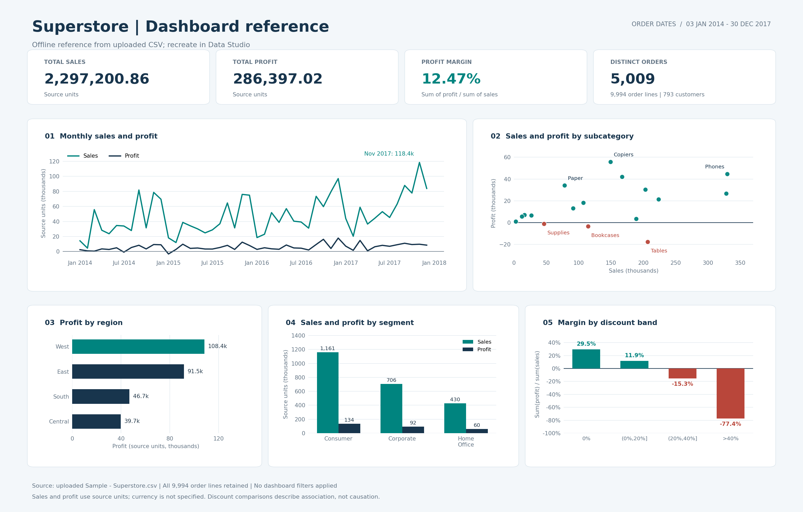

# รายงานโครงงานฉบับร่าง

## Superstore Retail Sales & Profit Analytics

**ระบบประมวลผลข้อมูลอัตโนมัติเพื่อวิเคราะห์ยอดขายและกำไรของธุรกิจค้าปลีก**

ผู้จัดทำ: [กรอกชื่อและรหัสนักศึกษา]  
รายวิชา/กลุ่มเรียน: [กรอกตามรายวิชา]  
วันนำเสนอที่ระบุในโจทย์: 21 พฤศจิกายน 2569

> **สถานะเอกสาร:** ตัวเลขและข้อค้นพบในรายงานนี้คำนวณจากไฟล์ CSV ที่ได้รับ และตรวจสอบด้วยการประมวลผลภายในเครื่องมือวิเคราะห์แล้ว ส่วนการรัน PostgreSQL บนเครื่องผู้จัดทำ การส่งข้อมูลเข้า Google Sheets การสร้าง Data Studio Report และการเผยแพร่ GitHub ยังต้องดำเนินการและแนบหลักฐานจริงก่อนส่งฉบับสมบูรณ์ ภาพ Dashboard ในเอกสารเป็นภาพอ้างอิงแบบออฟไลน์

## 1. ที่มาและความสำคัญ

ข้อมูลการขายสามารถใช้ศึกษาความแตกต่างของผลประกอบการตามช่วงเวลา หมวดสินค้า กลุ่มลูกค้า และพื้นที่ การพิจารณายอดขายร่วมกับกำไรช่วยให้เห็นว่ารายการขายกลุ่มใดสร้างผลตอบแทน และกลุ่มใดควรตรวจสอบเงื่อนไขการขายเพิ่มเติม อย่างไรก็ตาม ข้อมูลในไฟล์ต้นทางต้องผ่านการกำหนดชนิดข้อมูล การตรวจสอบคุณภาพ และการสรุปผลอย่างสม่ำเสมอก่อนนำไปใช้สร้างรายงาน

โครงงานนี้เลือกใช้ **Superstore Dataset** จาก Kaggle [1] โดยใช้ไฟล์ `Sample - Superstore.csv` ที่ได้รับเป็นหลักฐานข้อมูลสำหรับการวิเคราะห์ และเก็บสำเนาต้นฉบับในโปรเจกต์เป็น `data/raw/superstore.csv` [2] ชุดข้อมูลประกอบด้วยรายการสินค้าในคำสั่งซื้อ วันที่สั่งซื้อ วันที่จัดส่ง สินค้า ลูกค้า พื้นที่ ยอดขาย ส่วนลด และกำไร จึงรองรับการวิเคราะห์ทั้งแนวโน้มและความแตกต่างระหว่างกลุ่ม

ระบบที่ออกแบบใช้ Python อ่านไฟล์และจัดเก็บข้อมูลดิบใน PostgreSQL บน Docker จากนั้นใช้ Pandas แปลงข้อมูลและสร้างตารางพร้อมใช้งาน ก่อนส่งข้อมูลไป Google Sheets เพื่อใช้เป็นแหล่งข้อมูลของ Data Studio ตามสถาปัตยกรรมที่กำหนดในโจทย์

## 2. วัตถุประสงค์

1. จัดเตรียม Pipeline ที่นำข้อมูลจาก CSV เข้า PostgreSQL แปลงข้อมูล และเผยแพร่ผลไป Google Sheets ได้ด้วยคำสั่งหลักเพียงคำสั่งเดียว
2. ตรวจสอบและปรับรูปแบบข้อมูลโดยรักษาความหมายของรหัส วันที่ ยอดขาย และกำไร รวมถึงบันทึกสิ่งที่แก้ไขอย่างตรวจสอบย้อนกลับได้
3. วิเคราะห์คำถามทางธุรกิจ 5 ข้อ และออกแบบกราฟให้สอดคล้องกับหน่วยข้อมูลและตัวชี้วัด
4. จัดเตรียมโค้ด คู่มือ และค่าอ้างอิงสำหรับตรวจสอบผลลัพธ์ เพื่อให้ผู้อื่นรันระบบซ้ำได้หลังตั้งค่าสภาพแวดล้อมและสิทธิ์เข้าถึงของตนเอง

## 3. ขอบเขตและลักษณะข้อมูล

### 3.1 ข้อมูลที่ตรวจพบจริง

| รายการ | ผลตรวจจาก CSV |
|---|---:|
| จำนวนแถวต้นฉบับ | 9,994 |
| จำนวนคอลัมน์ต้นฉบับ | 21 |
| จำนวนคำสั่งซื้อที่ไม่ซ้ำ | 5,009 |
| จำนวนลูกค้าที่ไม่ซ้ำ | 793 |
| จำนวนรหัสสินค้าที่ไม่ซ้ำ | 1,862 |
| ช่วงวันที่สั่งซื้อ | 3 มกราคม 2014 ถึง 30 ธันวาคม 2017 |
| ช่วงวันที่จัดส่ง | 7 มกราคม 2014 ถึง 5 มกราคม 2018 |
| จำนวนเดือนตามวันที่สั่งซื้อ | 48 เดือน |
| ยอดขายรวมก่อนปัดเศษ | 2,297,200.8603 |
| กำไรรวมก่อนปัดเศษ | 286,397.0217 |
| จำนวนสินค้ารวม | 37,873 ชิ้น |
| อัตรากำไรรวม | 12.46721724% |

ยอดขายและกำไรในรายงานใช้ **หน่วยตามข้อมูลต้นฉบับ** เนื่องจาก CSV ไม่ได้ระบุคอลัมน์สกุลเงิน จึงไม่กำหนดเป็นเงินบาทหรือสกุลเงินอื่นโดยไม่มีข้อมูลยืนยัน ตัวเลขในตารางวิเคราะห์แสดงทศนิยม 2 ตำแหน่งเพื่อให้อ่านง่าย แต่การคำนวณใช้ค่าก่อนปัดเศษ

### 3.2 หน่วยของข้อมูลและนิยามตัวชี้วัด

หนึ่งแถวหมายถึง **รายการสินค้าในคำสั่งซื้อ** หรือ order line ซึ่งระบุด้วย `row_id` คำสั่งซื้อหนึ่งรายการอาจมีหลายแถว ดังนั้นต้องนับคำสั่งซื้อด้วยจำนวน `order_id` ที่ไม่ซ้ำ

| ตัวชี้วัด | วิธีคำนวณ |
|---|---|
| ยอดขายรวม | `SUM(sales)` |
| กำไรรวมตามชุดข้อมูล | `SUM(profit)` |
| อัตรากำไรรวม | `SUM(profit) / SUM(sales)` |
| จำนวนคำสั่งซื้อ | `COUNT_DISTINCT(order_id)` |
| จำนวนลูกค้า | `COUNT_DISTINCT(customer_id)` |
| ระยะเวลาจากสั่งซื้อถึงจัดส่ง | `ship_date - order_date` เป็นจำนวนวัน |

อัตรากำไรใช้ผลรวมกำไรหารด้วยผลรวมยอดขาย เพื่อถ่วงน้ำหนักตามยอดขาย จำนวนคำสั่งซื้อจากหลายกลุ่มสินค้าไม่ควรนำมาบวกกันโดยตรง เพราะคำสั่งซื้อเดียวอาจปรากฏในหลายกลุ่ม ส่วน `shipping_days` วัดช่วงจากวันสั่งซื้อถึงวันจัดส่งออก ไม่ได้ระบุเวลาที่สินค้าถึงลูกค้า

## 4. สถาปัตยกรรมและเครื่องมือ

| ขั้นตอน | โปรแกรม/เครื่องมือ | ข้อมูลเข้า | ผลลัพธ์ |
|---|---|---|---|
| เตรียมแหล่งข้อมูล | ดาวน์โหลดชุดข้อมูล Kaggle | ชุดข้อมูลที่เลือก | `data/raw/superstore.csv` |
| Ingestion | `ingest.py`, Pandas, SQLAlchemy | CSV ต้นฉบับ | `raw_data.superstore` ใน PostgreSQL |
| Storage | PostgreSQL 16 บน Docker | ข้อมูลดิบและผลแปลง | Schema `raw_data` และ `production` |
| Transformation | `transform.py`, Pandas | อ่าน `raw_data.superstore` จากฐานข้อมูล | ตารางรายละเอียดและตารางสรุปใน `production` |
| Publication | `publish.py`, gspread | อ่าน `production.sales_detail` จากฐานข้อมูล | Worksheet `dashboard_data` ใน Google Sheets |
| Visualization | Data Studio, Google Sheets Connector | Worksheet `dashboard_data` | Dashboard ที่ต้องสร้างจริงตามคู่มือ |
| Orchestration | `run_pipeline.py` | การตั้งค่าและไฟล์ต้นทาง | เรียก ingest, transform และ publish ต่อเนื่องกัน |

PostgreSQL ใช้ named volume เพื่อเก็บข้อมูลระหว่างการหยุดและเปิด Container พอร์ตสำหรับ Python บนเครื่องผู้จัดทำกำหนดเป็น `localhost:5433` โดย Docker ส่งต่อไปพอร์ต 5432 ภายใน Container โค้ดอ่านการตั้งค่าจาก `.env` และแยกข้อมูลลับออกจาก Source Code

### ตารางผลลัพธ์ที่เตรียมไว้

| ตารางใน Schema `production` | จำนวนแถวจากข้อมูลชุดนี้ | การใช้งาน |
|---|---:|---|
| `sales_detail` | 9,994 | รายละเอียด 28 คอลัมน์ เป็นแหล่งข้อมูลหลักสำหรับ Dashboard และตัวกรอง |
| `monthly_summary` | 48 | ยอดขายและกำไรรายเดือน |
| `subcategory_summary` | 17 | ผลประกอบการตามหมวดสินค้าและหมวดหมู่ย่อย |
| `region_summary` | 4 | ผลประกอบการตามภูมิภาค |
| `segment_summary` | 3 | ผลประกอบการตามกลุ่มลูกค้า |
| `discount_summary` | 4 | ผลประกอบการตามช่วงส่วนลด |

ชื่อและจำนวนตารางข้างต้นเป็นผลที่โค้ดออกแบบให้สร้าง และมีผลการแปลงแบบออฟไลน์สำหรับตรวจเทียบใน `reference_outputs/` [3] การมีไฟล์อ้างอิงเหล่านี้ยังไม่ใช่หลักฐานว่าตารางถูกสร้างบน PostgreSQL ของผู้จัดทำแล้ว

## 5. การตรวจสอบและแปลงข้อมูล

### 5.1 การเก็บข้อมูลดิบ

สคริปต์ `ingest.py` อ่าน CSV ด้วยชนิดข้อมูลข้อความเพื่อรักษารหัสและเลขศูนย์ด้านหน้า โดยรองรับ UTF-8 และ Windows-1252 ไฟล์ที่ได้รับอ่านได้ด้วย Windows-1252 จากนั้นปรับชื่อคอลัมน์ให้อยู่ในรูป snake_case เช่น `Order ID` เป็น `order_id` และ `Sub-Category` เป็น `sub_category` ขณะที่ค่าต้นฉบับยังคงอยู่ในตารางข้อมูลดิบ

### 5.2 ผลตรวจคุณภาพและแนวทางที่ใช้

| ประเด็น | สิ่งที่ตรวจพบ | การดำเนินการ |
|---|---|---|
| Missing values | ไม่พบค่าว่างในทั้ง 21 คอลัมน์ | บันทึกผลตรวจ โดยไม่สร้างหรือเติมข้อมูลเพิ่มเติม |
| แถวซ้ำทั้งแถว | ไม่พบ | ไม่ลบแถว |
| `row_id` ซ้ำ | ไม่พบ | กำหนดเป็น Primary Key ของตารางข้อมูลดิบและตารางรายละเอียด |
| รายการเหมือนกันเมื่อไม่นับ `row_id` | พบคู่ `3406` และ `3407` | เก็บทั้งคู่และบันทึกเป็นรายการที่ควรตรวจสอบ เพราะมีรหัสแถวต่างกัน |
| Non-breaking space ในชื่อสินค้า | พบ 225 แถว | แทนด้วยช่องว่างปกติ |
| ชื่อสินค้าที่เปลี่ยนจากการปรับช่องว่างและ trim รวม | 241 แถว | เก็บข้อความที่ปรับแล้วในตารางพร้อมใช้งาน |
| รหัสไปรษณีย์สหรัฐฯ สั้นกว่า 5 หลัก | 438 แถว | เติมเลขศูนย์ด้านหน้าให้ครบ 5 หลัก โดยเก็บเป็นข้อความ |
| กำไรติดลบ | 1,871 แถว | เก็บไว้เป็นผลขาดทุนที่ต้องนำไปวิเคราะห์ |
| รูปแบบวันที่ | รูปแบบเดือน/วัน/ปี | แปลงด้วย `%m/%d/%Y` อย่างชัดเจน |
| ตัวเลขและช่วงค่าพื้นฐาน | ไม่พบยอดขายหรือจำนวนสินค้าที่ไม่เป็นบวก และไม่พบส่วนลดนอกช่วง 0–1 | แปลงชนิดข้อมูลและคงการตรวจสอบไว้เมื่อรันซ้ำ |

ตัวเลข 225 และ 241 เป็นคนละนิยาม โดย 225 คือจำนวนแถวที่มี non-breaking space ส่วน 241 คือจำนวนแถวชื่อสินค้าที่เปลี่ยนหลังรวมการแทนช่องว่างชนิดดังกล่าวและการตัดช่องว่างหัวท้าย จึงไม่นำสองจำนวนนี้มาบวกกัน

สคริปต์จะหยุดเมื่อพบวันที่ ตัวเลข หรือรหัสที่จำเป็นไม่ถูกต้อง แทนการลบรายการหรือแทนตัวเลขที่อาจทำให้ยอดรวมคลาดเคลื่อน สำหรับคอลัมน์หมวดหมู่บางประเภทมีแนวทางแทนค่าที่หายด้วย `Unknown` แต่ข้อมูลที่ได้รับไม่ได้ใช้การแทนค่าดังกล่าว เพราะไม่มีค่าว่าง

### 5.3 Feature Engineering และ Aggregation

คอลัมน์ใหม่ประกอบด้วย `order_year`, `order_month`, `year_month`, `shipping_days`, `discount_band`, `discount_band_sort` และ `is_loss` โดย `order_month` ใช้วันแรกของเดือนพร้อมปี เพื่อป้องกันการรวมเดือนชื่อเดียวกันจากคนละปีเข้าด้วยกัน

ช่วงส่วนลดกำหนดอย่างชัดเจนเป็น 0%, มากกว่า 0% ถึง 20%, มากกว่า 20% ถึง 40% และมากกว่า 40% แต่ละตารางสรุปคำนวณยอดขาย กำไร จำนวนชิ้น จำนวนคำสั่งซื้อที่ไม่ซ้ำ จำนวนแถว และอัตรากำไรรวม

ข้อมูลชุดนี้มีไฟล์หลักเพียงไฟล์เดียว จึงไม่ต้อง Join กับชุดข้อมูลอื่น การรันซ้ำใช้การแทนที่เฉพาะตารางที่เป็นผลผลิตของ Pipeline แทนการ append ซ้ำ โดยการเขียนตารางในแต่ละขั้นตอนฐานข้อมูลอยู่ใน Transaction ไม่ควรตีความว่าการทำงานทั้ง Pipeline รวมถึง Google Sheets เป็น Transaction เดียวกัน

## 6. การตั้งค่า Google API Credentials และการเผยแพร่ข้อมูล

ขั้นตอนนี้ยังต้องดำเนินการด้วยบัญชีของผู้จัดทำและบันทึกหลักฐานจริง โดยมีแนวทางดังนี้

1. สร้างหรือเลือก Project ใน Google Cloud Console แล้วเปิดใช้ Google Sheets API และ Google Drive API ตามแนวทางการใช้งาน Service Account ของ gspread [4]
2. สร้าง Service Account สำหรับโปรเจกต์ ดาวน์โหลด Key แบบ JSON และเก็บในเครื่องเป็น `credentials.json` ห้ามเผยแพร่เนื้อหา Private Key หรือ commit ไฟล์นี้ขึ้น GitHub
3. สร้าง Spreadsheet สำหรับโครงงานด้วยบัญชี Google ของผู้จัดทำ และแชร์ Spreadsheet ให้ที่อยู่อีเมล `client_email` ของ Service Account ในระดับ Editor
4. คัดลอก Spreadsheet ID จาก URL มาใส่ `GOOGLE_SHEET_ID` ใน `.env` และกำหนดชื่อ Worksheet เป็น `dashboard_data`
5. รัน `python run_pipeline.py` หลังตั้งค่าฐานข้อมูลและสิทธิ์ครบ สคริปต์จะอ่านข้อมูลจาก `production.sales_detail` ก่อนส่งไป Google Sheets
6. ตรวจว่า Worksheet มีข้อมูล 9,994 แถวและหัวตารางอีก 1 แถว จากนั้นตรวจยอดรวมและชนิดข้อมูลวันที่/ตัวเลขก่อนเชื่อม Data Studio

การเขียน Google Sheets ใช้โหมด `RAW` เพื่อรักษาข้อความและรหัส วันที่ถูกส่งเป็นค่า Serial พร้อมรูปแบบวันที่ ส่วนยอดขายและกำไรส่งเป็นตัวเลข การอัปเดตคง Worksheet เดิมไว้เพื่อรักษา Sheet ID ที่ใช้เชื่อม Dashboard ทั้งนี้การส่งข้อมูลหลายช่วงยังมีโอกาสสำเร็จเพียงบางส่วนหากเกิดข้อผิดพลาดระหว่างทาง จึงต้องตรวจผลการรันก่อนใช้งานรายงานทุกครั้ง

กรณีต้องการตรวจฐานข้อมูลก่อนตั้งค่า Google ใช้ `python run_pipeline.py --skip-publish` ได้ แต่ผลการรันแบบนี้ยังไม่ครอบคลุมขั้นตอนเผยแพร่ขึ้น Google Sheets

## 7. คำถามวิเคราะห์และการออกแบบ Dashboard

| ข้อ | คำถาม | กราฟที่ออกแบบ | มิติและตัวชี้วัดหลัก |
|---|---|---|---|
| 1 | ยอดขายและกำไรเปลี่ยนแปลงอย่างไรในแต่ละเดือน | Time series | เดือนพร้อมปี, ยอดขายรวม, กำไรรวม |
| 2 | หมวดหมู่ย่อยใดมียอดขายสูง แต่กำไรต่ำหรือขาดทุน | Scatter chart | หมวดหมู่ย่อย, ยอดขายรวมแกน X, กำไรรวมแกน Y |
| 3 | ภูมิภาคใดสร้างกำไรมากที่สุด | Horizontal bar chart | ภูมิภาค, กำไรรวม |
| 4 | กลุ่มลูกค้าใดสร้างยอดขายและกำไรมากที่สุด | Grouped bar chart | กลุ่มลูกค้า, ยอดขายรวม, กำไรรวม |
| 5 | ระดับส่วนลดสัมพันธ์กับอัตรากำไรอย่างไร | Bar chart | ช่วงส่วนลด, ผลรวมกำไรหารด้วยผลรวมยอดขาย |

หน้า Dashboard ที่จะสร้างควรมีตัวกรองช่วงวันที่ ภูมิภาค และหมวดสินค้า พร้อมตัวเลขภาพรวมยอดขาย กำไร อัตรากำไร และจำนวนคำสั่งซื้อ วิธีตั้งค่า Data Studio อยู่ใน [คู่มือ Dashboard](dashboard_guide.md)

**ภาพนี้เป็นภาพอ้างอิงสำหรับจัดวางและตรวจสอบค่ากราฟ ไม่ใช่ภาพหน้าจอจาก Data Studio ที่สร้างและเชื่อมต่อแล้ว** สามารถสร้างภาพใหม่ด้วย `python scripts/render_reference.py` หลังติดตั้ง matplotlib เพิ่มเติม

## 8. ผลการวิเคราะห์จากข้อมูลจริง

ผลในหัวข้อนี้คำนวณจาก CSV ทุกแถว โดยยังไม่ใช้ตัวกรอง Dashboard จำนวนเงินทั้งหมดใช้หน่วยตามข้อมูลต้นฉบับ และอัตรากำไรคำนวณจากผลรวมของกลุ่มนั้น [2][3]

### 8.1 แนวโน้มยอดขายและกำไรตามเวลา

| ปีที่สั่งซื้อ | ยอดขายรวม | กำไรรวม | อัตรากำไร |
|---|---:|---:|---:|
| 2014 | 484,247.50 | 49,543.97 | 10.23% |
| 2015 | 470,532.51 | 61,618.60 | 13.10% |
| 2016 | 609,205.60 | 81,795.17 | 13.43% |
| 2017 | 733,215.26 | 93,439.27 | 12.74% |

ปี 2017 มียอดขายสูงสุดในช่วงข้อมูล โดยยอดขายเพิ่มขึ้น **20.36%** จากปี 2016 ขณะที่กำไรเพิ่มขึ้น **14.24%** และอัตรากำไรลดจาก 13.43% เป็น 12.74% จึงควรตรวจองค์ประกอบสินค้า ส่วนลด และกลุ่มลูกค้าของปีดังกล่าวประกอบกัน

ในระดับเดือน **พฤศจิกายน 2017 มียอดขายสูงสุด 118,447.83** แต่กำไรอยู่ที่ 9,690.10 ขณะที่ **ธันวาคม 2016 มีกำไรรวมสูงสุด 17,885.31** จากยอดขาย 96,999.04 ผลนี้แสดงว่าการเลือกเดือนที่ต้องตรวจสอบควรใช้ทั้งยอดขายและกำไรร่วมกัน

### 8.2 หมวดหมู่ย่อยที่ควรตรวจสอบผลกำไร

| หมวดหมู่ย่อย | ยอดขายรวม | กำไรรวม | อัตรากำไร |
|---|---:|---:|---:|
| Tables | 206,965.53 | -17,725.48 | -8.56% |
| Bookcases | 114,880.00 | -3,472.56 | -3.02% |
| Supplies | 46,673.54 | -1,189.10 | -2.55% |
| Machines | 189,238.63 | 3,384.76 | 1.79% |
| Copiers | 149,528.03 | 55,617.82 | 37.20% |

พบหมวดหมู่ย่อยที่ขาดทุนรวม 3 กลุ่ม คือ **Tables, Bookcases และ Supplies** โดย Tables ขาดทุนสูงสุดในระดับหมวดหมู่ย่อย ส่วน Machines มียอดขายค่อนข้างสูงเมื่อเทียบกับกำไรที่ได้รับ ในทางกลับกัน Copiers สร้างกำไรรวมสูงสุดของหมวดหมู่ย่อยทั้งหมด

ข้อเสนอจากผลนี้คือเริ่มตรวจรายการสินค้าและระดับส่วนลดภายใน Tables, Bookcases และ Supplies พร้อมพิจารณาต้นทุนและเงื่อนไขการขายเพิ่มเติม ก่อนตัดสินใจปรับนโยบายสินค้า

### 8.3 ความแตกต่างระหว่างภูมิภาค

| ภูมิภาค | ยอดขายรวม | กำไรรวม | อัตรากำไร |
|---|---:|---:|---:|
| West | 725,457.82 | 108,418.45 | 14.94% |
| East | 678,781.24 | 91,522.78 | 13.48% |
| South | 391,721.91 | 46,749.43 | 11.93% |
| Central | 501,239.89 | 39,706.36 | 7.92% |

**West มีทั้งกำไรรวมและอัตรากำไรสูงสุด** ส่วน Central มียอดขายสูงกว่า South แต่กำไรรวมและอัตรากำไรต่ำกว่า ควรใช้ Dashboard เจาะดูหมวดสินค้าและส่วนลดใน Central เพื่อระบุว่าความแตกต่างเกิดจากกลุ่มใด โดยผลรวมระดับภูมิภาคเพียงอย่างเดียวยังไม่อธิบายสาเหตุ

### 8.4 ผลประกอบการตามกลุ่มลูกค้า

| กลุ่มลูกค้า | ยอดขายรวม | กำไรรวม | อัตรากำไร |
|---|---:|---:|---:|
| Consumer | 1,161,401.35 | 134,119.21 | 11.55% |
| Corporate | 706,146.37 | 91,979.13 | 13.03% |
| Home Office | 429,653.15 | 60,298.68 | 14.03% |

**Consumer สร้างยอดขายและกำไรรวมมากที่สุด** โดยคิดเป็น 50.56% ของยอดขายทั้งหมด ขณะที่ Home Office มีอัตรากำไรสูงสุดในสามกลุ่ม การวางแผนจึงอาจใช้ Consumer เป็นฐานด้านปริมาณยอดขาย และศึกษาสินค้าหรือเงื่อนไขที่ทำให้ Home Office มีอัตรากำไรสูง เพื่อหาทางเพิ่มกำไรในกลุ่มอื่น

### 8.5 ความสัมพันธ์ระหว่างส่วนลดกับอัตรากำไร

| ช่วงส่วนลด | จำนวน order lines | ยอดขายรวม | กำไรรวม | อัตรากำไร |
|---|---:|---:|---:|---:|
| 0% | 4,798 | 1,087,908.47 | 320,987.60 | 29.51% |
| มากกว่า 0% ถึง 20% | 3,803 | 846,522.24 | 100,785.47 | 11.91% |
| มากกว่า 20% ถึง 40% | 460 | 234,137.90 | -35,817.47 | -15.30% |
| มากกว่า 40% | 933 | 128,632.25 | -99,558.59 | -77.40% |

กลุ่มส่วนลดมากกว่า 20% ทั้งสองช่วงมีกำไรรวมติดลบ รวมกันเป็น **-135,376.06** และในกลุ่มส่วนลดมากกว่า 40% พบกำไรติดลบทุกรายการทั้ง 933 แถว ข้อมูลจึงให้เหตุผลในการตรวจสอบรายการที่มีส่วนลดสูงเป็นลำดับต้น

ผลนี้เป็น **ความสัมพันธ์เชิงพรรณนา** ระดับส่วนลดอาจเกี่ยวข้องกับประเภทสินค้า ต้นทุน พื้นที่ หรือกลยุทธ์การขายที่ต่างกัน การเปรียบเทียบนี้ยังไม่พิสูจน์ว่าส่วนลดเป็นสาเหตุเพียงอย่างเดียว และไม่สามารถสรุปว่าการยกเลิกส่วนลดจะทำให้ยอดขายหรือกำไรเปลี่ยนเท่าใดโดยตรง

## 9. การตรวจสอบผลและสถานะการดำเนินงาน

### 9.1 สิ่งที่ตรวจสอบแล้วในขั้นเตรียมโครงงาน

- อ่านไฟล์จริงได้ครบ 9,994 แถวและ 21 คอลัมน์ พร้อมตรวจ Encoding วันที่ ค่าว่าง รหัสซ้ำ และค่าตัวเลข
- รันการแปลงข้อมูลด้วย Pandas ได้ตารางรายละเอียด 9,994 แถว โดยไม่ลบรายการขาดทุนหรือคู่รายการที่มี `row_id` ต่างกัน
- ตรวจเทียบยอดขาย 2,297,200.8603 และกำไร 286,397.0217 กับการคำนวณอิสระจากไฟล์ต้นทาง
- ตรวจให้ผลรวมยอดขายและกำไรของตารางสรุปทั้ง 5 ตารางสอดคล้องกับตารางรายละเอียด
- ทดสอบตัวอย่างข้อมูลวันที่ผิด ตัวเลขผิด และ `row_id` ซ้ำให้ถูกปฏิเสธแทนการประมวลผลต่ออย่างเงียบ ๆ
- ชุดทดสอบออฟไลน์ในโปรเจกต์ผ่านครบ **11 กรณี** โดยยังไม่ครอบคลุมการเชื่อมต่อบริการฐานข้อมูลและ Google จริง
- สร้างไฟล์สรุปและภาพอ้างอิง Dashboard จากผลออฟไลน์ เพื่อใช้ตรวจเทียบเมื่อสร้างรายงานจริง

### 9.2 งานที่ต้องยืนยันด้วยการใช้งานจริง

| ส่วนงาน | สถานะในร่างนี้ | หลักฐานที่ต้องเพิ่ม |
|---|---|---|
| PostgreSQL บน Docker | เตรียมไฟล์และโค้ดแล้ว แต่ยังไม่ยืนยันผลบนเครื่องผู้จัดทำ | ภาพ `docker compose ps` ที่แสดง healthy และผล Query จำนวนแถว/ยอดรวม |
| Pipeline ผ่านฐานข้อมูล | เตรียม ingest และ transform แล้ว | Log การรันจริงและผลตรวจ `raw_data` / `production` |
| Google API Credentials | มีคำอธิบายและตัวแปรการตั้งค่า | ภาพแสดงการเปิด API และการแชร์ Sheet โดยปิดบังข้อมูลลับ |
| การเผยแพร่ Google Sheets | เตรียม `publish.py` แล้ว | ภาพ Worksheet ที่มีข้อมูลและผลรวมถูกต้องหลังรันจริง |
| Data Studio Dashboard | มีแบบกราฟและคู่มือ | ภาพ Dashboard จริง ตัวกรองที่ใช้งานได้ และลิงก์เปิดดูรายงาน |
| GitHub Repository | มีไฟล์พร้อมจัดทำ Repository | URL Repository และการตรวจว่าไม่มี `.env` / `credentials.json` ถูก commit |
| รายงานส่งฉบับสมบูรณ์ | ร่างเนื้อหาและผลวิเคราะห์แล้ว | กรอกข้อมูลผู้จัดทำ แทรกหลักฐานจริง และปรับสถานะตามที่ดำเนินการสำเร็จ |

คำสั่ง `python -m unittest discover -s tests -v` ใช้ตรวจการแปลงข้อมูลและพฤติกรรมที่ทดสอบภายในโปรเจกต์ แต่ผลผ่านของชุดทดสอบไม่แทนหลักฐานการเชื่อม PostgreSQL หรือ Google จริง เมื่อรัน Pipeline แล้วควรใช้คำสั่ง SQL ใน `sql/validation_queries.sql` ตรวจจำนวนแถวและยอดรวมอีกครั้ง

## 10. ข้อจำกัดและแนวทางต่อยอด

1. ข้อมูลเป็นช่วงปี 2014–2017 ผลวิเคราะห์อธิบายชุดข้อมูลย้อนหลังนี้ และไม่ได้แสดงสภาพตลาดค้าปลีกปัจจุบัน
2. CSV ไม่ได้ระบุสกุลเงินหรือรายละเอียดองค์ประกอบต้นทุนทั้งหมด การเรียกกำไรอ้างอิงเฉพาะฟิลด์ `Profit` ไม่ขยายความเป็นกำไรสุทธิทางบัญชีโดยไม่มีข้อมูลเพิ่ม
3. คู่รายการ `3406` และ `3407` อาจต้องตรวจสอบกับแหล่งข้อมูล แต่ยังไม่มีหลักฐานพอให้ลบทิ้ง การเก็บไว้รักษาความครบถ้วนของไฟล์ที่ได้รับ
4. การวิเคราะห์ส่วนลดและกำไรเป็นเชิงพรรณนา ยังไม่ได้ควบคุมผลของสินค้า พื้นที่ หรือปัจจัยอื่น และไม่ได้ประเมินเหตุและผล
5. การอัปเดต Pipeline จากไฟล์เดิมไม่ได้ทำให้ข้อมูลใหม่เกิดขึ้นเอง หากต้องการปรับปรุงข้อมูลต้องแทนที่ไฟล์ต้นทางด้วยเวอร์ชันที่ได้รับอนุญาตและตรวจรูปแบบก่อนรัน
6. การพัฒนาครั้งต่อไปอาจเพิ่มตารางประวัติการรัน การแจ้งเตือนข้อผิดพลาด และการตรวจความเปลี่ยนแปลงของโครงสร้างข้อมูล โดยยังคงตรวจยอดรวมก่อนเผยแพร่ทุกครั้ง

## 11. ข้อมูลสำหรับส่งงานที่ต้องกรอกหลังดำเนินการจริง

| รายการ | ข้อมูล |
|---|---|
| GitHub Repository | [เติม URL หลังสร้างและตรวจไฟล์แล้ว] |
| Data Studio Report | [เติม URL หลังสร้าง Dashboard จริง] |
| การตั้งค่าสิทธิ์ Data Studio | [ยืนยันว่า Anyone with the link can view ตามโจทย์] |
| วันที่และเวลาทดสอบ Pipeline สำเร็จ | [กรอกตาม Log จริง] |
| สภาพแวดล้อมที่ใช้รันจริง | [ระบบปฏิบัติการ, Python, Docker และเวอร์ชันที่ใช้] |

## แหล่งข้อมูลและเอกสารอ้างอิง

1. Kaggle. **Superstore Dataset** โดย vivek468. <https://www.kaggle.com/datasets/vivek468/superstore-dataset-final>
2. ไฟล์ที่ได้รับ **Sample - Superstore.csv.zip** ซึ่งมี `Sample - Superstore.csv` ขนาด 2,287,806 ไบต์ สำเนาที่ใช้ในโปรเจกต์: [`data/raw/superstore.csv`](../data/raw/superstore.csv) และรายละเอียดแหล่งข้อมูล: [`data/raw/README.md`](../data/raw/README.md)
3. ผลการแปลงแบบออฟไลน์และข้อมูลตรวจสอบ: [`reference_outputs/data_quality.json`](../reference_outputs/data_quality.json), [`reference_outputs/source_manifest.json`](../reference_outputs/source_manifest.json) และไฟล์ CSV สรุปทั้ง 5 ตารางใน [`reference_outputs/`](../reference_outputs/)
4. gspread. **Authentication — For Bots: Using Service Account**. <https://docs.gspread.org/en/latest/oauth2.html#for-bots-using-service-account>
5. เอกสาร **Project Assignment.pdf** ที่ผู้สอนมอบหมาย ใช้กำหนดกระบวนการ เครื่องมือ สิ่งส่งมอบ และวันนำเสนอ

เอกสารวิธีรันฉบับใช้งานอยู่ใน [`README.md`](../README.md) ส่วนรายละเอียดการสร้างกราฟอยู่ใน [`dashboard_guide.md`](dashboard_guide.md)
